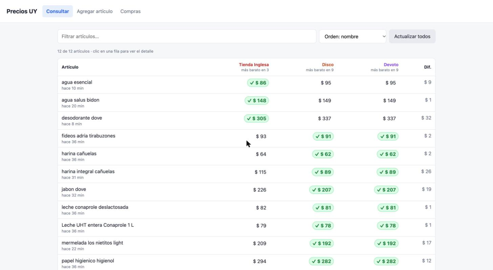
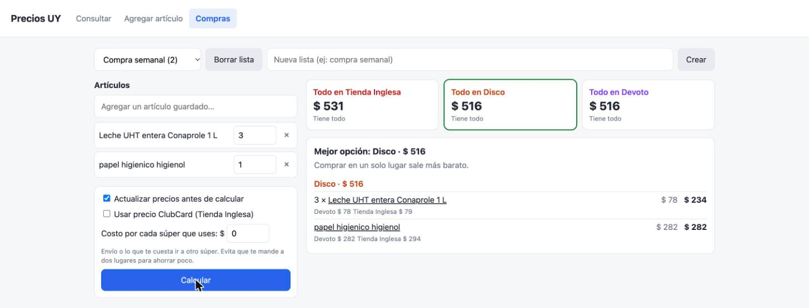

# precios-uy

Comparador de precios de supermercados de Uruguay: Tienda Inglesa, Disco y Devoto.





- **Agregar artículo:** busca en los tres súper, marcás el mismo producto en cada uno y se guarda en SQLite (`precios.db`). Disco y Devoto comparten ids: marcando uno se completa el otro.
- **Consultar:** tabla con el precio de cada artículo en cada súper, el más barato marcado.
- **Compras:** listas con cantidades; total en cada súper y la combinación más barata, con costo opcional por súper usado y precio ClubCard.

## Uso

```sh
./run.sh          # http://localhost:8765
./run.sh 9000     # otro puerto
```

Python 3.9+, sin dependencias.

## De dónde salen los precios

Ninguno tiene API pública.

- **Tienda Inglesa:** el buscador (`/supermercado/busqueda`) trae los precios en un JSON embebido en la página.
- **Disco / Devoto:** el buscador es Blazor (websocket), así que se indexa el sitemap (~71k productos, una vez por día) y el precio sale del JSON-LD de cada página de producto.
